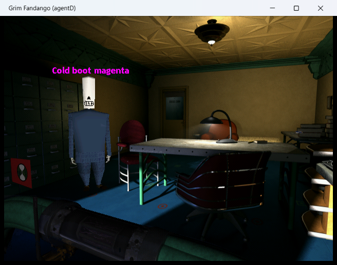
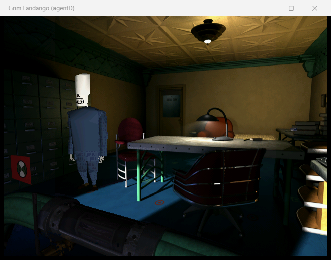
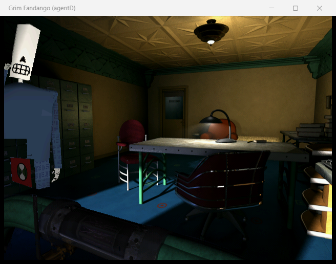

# Learning and modifying Grim Fandango with this tree

This repository contains a rebuild of `GRIMFANDANGO.EXE` v1.01 (GOG) and its three engine DLLs (`LUA.DLL`,
`IMUSE.DLL`, `CHORE.DLL`) from a Ghidra decompilation. The rebuilt EXE **runs the real game**: it boots to Manny's
office, walks, plays movies, dialogue, inventory, save/load and door scene changes (see `build/BUILD_NOTES.md` for
the history). It reads the game's own data (the `.LAB` archives of your installation), which are not part of this
repository.

This guide shows how to build it, run it, look around the code, and change the game in three ways:

1. **no rebuild** - override Lua scripts, set files and other resources with loose files (example mods c and d);
2. **rebuild** - change engine behaviour in C (example mod a);
3. **rebuild** - add new C functions that Lua scripts can call (example mod b).

Everything in this document was run on this machine; the numbers in the "before / after" tables are measurements,
not estimates. Windows paths are written with forward slashes (`C:/GOG Games/GRIMDATA`) because every tool here runs
in the MSYS2 shell.

Contents: [Prerequisites](#1-prerequisites) - [Tree map](#2-tree-map) - [C or assembly?](#3-c-or-assembly-what-is-actually-compiled) -
[Edit, build, run](#4-the-edit-build-run-loop) - [Running and the test knobs](#5-running-the-game-and-the-test-knobs) -
[Where the game finds its files](#6-where-the-game-finds-its-files-and-how-to-override-them) -
[Lua scripts](#7-lua-scripts) - [C functions in Lua](#8-how-the-engine-exposes-c-functions-to-lua-and-how-to-add-one) -
[Subsystem map](#9-subsystem-map) - [Example mods](#10-example-mods) - [Debugging](#11-debugging) -
[Regenerating from Ghidra](#12-regenerating-src-after-edits-in-ghidra) - [Pitfalls](#13-known-limits-and-pitfalls)

## 1. Prerequisites

| What | Where / how |
|---|---|
| The game | a GOG install of Grim Fandango; this machine: `C:/GOG Games/GRIMDATA` (registry value `GrimDataDir`, see 6) |
| MSYS2 UCRT64 | `C:/msys64`; the build uses `gcc -m32 -march=i686` from `/ucrt64/bin` for objects and the i686 toolchain `/mingw32/bin/gcc` for linking. Use the **Bash** shell with `export PATH=/ucrt64/bin:$PATH`. |
| Python 3 | always run scripts as `python -I tools/<script>.py` (isolated mode: no stray modules from the current directory) |
| `raw/` | 28 MB dump of the Ghidra project (git-ignored, regenerable). **Compiling** needs only `src/`; **linking** (`make link`) also reads `raw/<prog>/` (section contents, strings, globals). A fresh clone has no `raw/`: it is produced by `python -I tools/export_raw.py` from a running Ghidra project `grim` with the ghidra-mcp bridge on `127.0.0.1:8089` (about 20 minutes). |
| Ghidra bridge | only for the naming / regeneration workflow (12), not for building or modding |

The Windows registry on a GOG install already has the game key
`HKLM/SOFTWARE/WOW6432Node/LucasArts Entertainment Company LLC/Grim Fandango/v1.0` with `GrimDataDir`,
`Requesters/*Path` and (on this machine) `TextAllowed = true`, which is required for loose **text** Lua scripts (7).

## 2. Tree map

```
README.md              project overview, naming conventions, coverage
docs/MODDING.md       this guide;  docs/LUA_API.md  the 319 Lua functions the engine registers (generated)
names/*.json           curated symbol batches (function names, prototypes, comments) - input of tools/apply_names.py;
                       names/asm_funcs.json (which functions are assembled), asm_extra.json, asm_exclude.json,
                       asm_patches.json: see 3
tools/                 Python: export_raw / export_changed (Ghidra -> raw/), build_src (raw/ -> src/), gen_asm
                       (assembly mode), apply_names, lab.py (LAB archives), luadump.py (Lua bytecode),
                       list_lua_api.py, run_game.sh, lua_cmd.sh, grim_shot.ps1, mkmoddir.sh, many audit scripts
build/                 Makefile, link.py + gendata.py (linker, data sections), compat.h (force-included header),
                       overrides.c (hand-written C that replaces decompiled functions), startup.c (WinMain),
                       win32_shims.c, run/ (git-ignored: the 4 binaries you run), obj/ (git-ignored build output),
                       BUILD_NOTES.md (history of every bug class met on the way to a running game)
raw/                   GENERATED, git-ignored: Ghidra's decompilation text per function + sections, strings, ...
src/<PROG>/            GENERATED from raw/ by tools/build_src.py but committed. One .c file per original module
                       (rdcache.c, sector.c, ...), plus ghidra_types.h, globals.h, functions.h, FUNCTIONS.md and
                       asm_funcs.s. Never edit by hand: the next build_src run overwrites it.
mods/                  example mods of 10 (loose-file mods have an install.sh)
```

`<PROG>` is `GRIMFANDANGO.EXE` (135 `.c` modules), `LUA.DLL` (31), `IMUSE.DLL` (13) or `CHORE.DLL` (5). The module a
function lives in is derived from the original source file names the binary leaks (`C:\grimsrc\libs\grimlib\...`,
`C:\grimjedi\Libs\...`, see README) and from its name prefix; `src/<PROG>/FUNCTIONS.md` lists every function with
address and module.

**Where changes go.** Because `src/` is regenerated, there are exactly four places where you change behaviour:

| You want to... | Edit |
|---|---|
| replace the body of one function by C you write | `build/overrides.c` (the generated copy of that function is then put under `#if 0`) |
| insert a few instructions into an assembled function | `names/asm_patches.json` |
| change the data the program is built from or how code is generated | `tools/build_src.py`, `tools/gen_asm.py`, `build/*.py` |
| change a name, prototype or comment | Ghidra (system of record), then 12 |

## 3. C or assembly? What is actually compiled

Ghidra's C is a description of machine code, not a faithful program (x87 return values, register calling
conventions and lost arguments are all wrong in places, see `build/BUILD_NOTES.md`). So the build has two modes per
function:

* **C mode** - the decompiled text in `src/<PROG>/<module>.c` is compiled by gcc.
* **Assembly mode** - the *original instructions* of the function are re-emitted from Ghidra's disassembly into
  `src/<PROG>/asm_funcs.s` (symbolic references instead of absolute addresses) and assembled. The C text stays in
  `src/` under `#if 0` for reading.

| Program | functions (without thunks) | assembled |
|---|---|---|
| GRIMFANDANGO.EXE | 2604 | 811 (low half 0x401000-0x49ffff: 473, of which 372 are the software rasteriser; list and reasons in docs/ASM_REMAINING.md) |
| LUA.DLL | 850 | 178 |
| IMUSE.DLL | 434 | 282 |
| CHORE.DLL | 264 | 258 |

**How to tell which one a function is.** Open its C text: assembled functions carry the line
`/* NOT COMPILED: the build uses the original machine code of this function (src/<PROG>/asm_funcs.s, ...) */`
and functions replaced by hand carry `/* replaced by the hand-written version in build/overrides.c */`.
Everything else is compiled C. (`names/asm_funcs.json` holds the list per program.) Editing the `#if 0` text of
either kind does nothing - and `src/` is regenerated anyway. Almost the whole Lua API (`lua.c`), the actor and walker
modules, the renderer and the costume DLL are assembled; the set/sector, text and save code is C.

**Which functions get assembled** (`python -I tools/gen_asm.py <PROG> --select`): the COM-calling DirectX modules,
functions whose decompilation contains artifacts (x87 state, register values crossing calls), the hand-picked list
`names/asm_extra.json`, minus `names/asm_exclude.json` (functions that broke when assembled, e.g.
`ModelComponent_Create`) and minus every function that `build/overrides.c` defines.

To make a change to an assembled function you either override it in C (10 a does this to `Actor_UpdateWalker`: write the
function in `overrides.c`, then rerun `gen_asm.py ... --select` so the assembled copy is dropped) or patch the
instructions with `names/asm_patches.json` (10 b uses this to call a registration function from the Lua start-up code):

```json
"GRIMFANDANGO.EXE": { "0049de00": { "0049de7c": [ "call _GRIM_RegisterModApi" ] } }
```

meaning: in the function at 0x49de00, after the instruction at 0x49de7c, insert these lines of Intel-syntax assembly
(local labels as `9:` / `9f`; C symbols carry a leading underscore).

## 4. The edit, build, run loop

```bash
export PATH=/ucrt64/bin:$PATH
cd C:/Users/Joel/grim-agentD/build
make link -j14                      # ~20 s: compiles src/*.c to obj/, links the four PE files into obj/<PROG>/
mkdir -p run
cp obj/GRIMFANDANGO.EXE/grimfandango.exe obj/LUA.DLL/lua.dll obj/IMUSE.DLL/imuse.dll obj/CHORE.DLL/chore.dll run/
```

`make` alone only compiles `src/` to objects; `build/overrides.c`, the assembled code and the data sections are
compiled/linked by `link.py`, so **always use `make link`** after editing `overrides.c`. You cannot copy over a running
`grimfandango.exe` (stop your instance first; only ever stop a process whose path is in *your* checkout).

Which command to run after which change:

| You changed | Run (in the repo root unless stated) |
|---|---|
| `build/overrides.c` only, no function removed from assembly | `make -C build link` |
| `build/overrides.c`, you override a function that is currently assembled | `python -I tools/build_src.py && python -I tools/gen_asm.py GRIMFANDANGO.EXE --select && python -I tools/build_src.py && make -C build link` |
| `names/asm_extra.json`, `asm_exclude.json`, `asm_patches.json` | `python -I tools/gen_asm.py <PROG> --select && python -I tools/build_src.py && make -C build link` |
| `tools/build_src.py` (generator) | `python -I tools/build_src.py && make -C build link` |
| a name/prototype in Ghidra | 12 |

The order `build_src` -> `gen_asm` -> `build_src` matters after any rename: `gen_asm.py` takes the C symbol of every
function from `src/<PROG>/functions.h`, so it must run after a `build_src` that knows the new names (a stale
`asm_funcs.s` leaves the old `FUN_` names undefined: the link then reports "stubbed" symbols and the game faults).
`make -C build link` ends with a line per program, e.g.
`GRIMFANDANGO.EXE: LINKED -> ...; 11 symbols stubbed {'other': 11}`; these 11 are MSVC runtime helpers the host runtime
replaces. A jump in that number after your change is a bug to look at first.

## 5. Running the game and the test knobs

```bash
tools/run_game.sh -d C:/Users/Joel/agentD_clean -t dev    # start in the background, window "Grim Fandango (dev)"
tools/lua_cmd.sh 'grimlog("hello "..GetTickCount())'      # run a line of Lua in the running game, show the log
powershell -ExecutionPolicy Bypass -File tools/grim_shot.ps1 -Out shot.png -Tag dev    # window screenshot
```

* The game's **working directory** matters (6): `-d` selects it. Without `-d` the script uses
  `C:/GOG Games/GRIMDATA`, which makes the game write its logs and save files into your real install - prefer a
  separate directory made by `tools/mkmoddir.sh <dir>` (copies the four audio support files, see 6).
* Booting to Manny's office takes about 1.5 to 2 minutes (the Lua boot scripts run in an unoptimised `-O0` build).
  Wait for it with a loop like `until grep -q '^READY' ~/grim_log.txt; do tools/lua_cmd.sh 'if manny and manny.hActor then grimlog("READY") end' >/dev/null; done`.
* `tools/grim_shot.ps1` uses `PrintWindow`, so the window may be behind others. **Never send OS-level keyboard or
  mouse input to the game** (other sessions run copies at the same time); use the hook below.

Environment variables read by the rebuilt EXE (set them before `tools/run_game.sh`, which passes them on):

| Variable | Effect | Defined in |
|---|---|---|
| `GRIM_MULTI=<tag>` | allow several instances; window title "Grim Fandango (<tag>)" (the original quits if its window exists) | `overrides.c` `Win_AbortIfAlreadyRunning` |
| `GRIM_NOMOVIE=1` | skip all movies (cleared every frame) | `GRIM_lua_cmd_poll` |
| `GRIM_ACTIVE=1` | draw and present even when the window is not the foreground window | `GRIM_lua_cmd_poll` |
| `GRIM_LUA_FILE=<file>` | the **Lua test hook**: every complete line appended to this file runs as Lua once per frame (also while a menu pauses the engine) | `GRIM_lua_cmd_poll` |
| `GRIM_LUA_LOG=<file>` | target of `grimlog("text")` and of the hook's `rc=0: <line>` result lines | same |
| `GRIM_DISPLAY_DEVICE=<n>` | pick another enumerated display device (1 = DirectDraw); default 0 = windowed DIB, software renderer | `Display_InitFromConfig` |
| `GRIM_WALK_SCALE=<float>` | example mod 10 a: walk speed factor | `overrides.c` |

`GRIM_LUA_FILE` and `GRIM_LUA_LOG` take **Windows paths with backslashes** (`C:\Users\Joel\x.lua`): a forward-slash MSYS
path makes the hook silently skip the file (`tools/run_game.sh` converts with `cygpath -w`). The hook calls
`lua_dostring` per line, so each line must be complete Lua 3.1 on its own line. Lua 3.1 has no numeric `for` loop (use
`while`) and no `--[[ ]]` comments; the game's task functions `start_script(f)`, `break_here()`, `sleep_for(ms)` run
code over several frames.

An unhandled exception writes `grim_crash.txt` (registers, three frame arguments, a stack dump) into the working
directory; resolve the addresses with `nm -n build/obj/GRIMFANDANGO.EXE/grimfandango.exe`.

## 6. Where the game finds its files, and how to override them

All reads of game data go through one layer, `ResFile_Open` (`src/GRIMFANDANGO.EXE/resfile.c`), the file services that
Lua, the resource loader and the set parser use (`Res_InstallFileServices`). For a read-mode open of a name without a
directory part it first asks the **list of open archives** (`Lab_FindFile`, `lab.c`) and only when no archive has the
file does it fall back to a plain `fopen(name)` relative to the working directory. Names containing a backslash skip
the archive list and are opened directly.

### The archive list and its priority

`Resource_OpenArchives` (`resource.c`) fills the list at start-up, for three directories in this order, each of which
**ends up in front of the ones before it**:

1. the registry value `GrimDataDir` of the game key (here `C:\GOG Games\GRIMDATA\`) - skipped if equal to the working directory;
2. the "extra data directory" (`Engine_SetExtraDataDir`, normally unset);
3. the **working directory** of the process.

For each directory `Resource_OpenArchivesInDir` opens every `*.LAB` in alphabetical order (later = in front: a
`DATA005.LAB` patch archive wins over `DATA000.LAB`), then opens **the directory itself as a pseudo-archive**
(`LabDir_Open`, "developer mode"), then the 30 subdirectories of the table `g_ppRequiredLabs`
(`Animation\ Backgrounds\ Costumes\ Colormaps\ Fonts\ Materials\ Models\ Movies\ Objects\ Scripts\ Sets\ Voices\
Footsteps\ SFX\ Loops\` and the same 15 prefixed `DEBUG_`), each moved to the front in table order. A directory is only
used if it exists *and contains files* at that moment.

So the search order for a file name is, front to back:

```
<cwd>\DEBUG_Loops, DEBUG_SFX, ... DEBUG_Scripts ... DEBUG_Animation      (the debug directories win over everything)
<cwd>\Loops, SFX, ... Scripts ... Animation
<cwd> itself (loose files next to the executable's working directory)
<cwd>\*.LAB (if any, last one first)
<GrimDataDir>\ the same sequence, then its LABs: DATA005.LAB ... DATA000.LAB, CREDITS.LAB, MOVIE*.LAB, VOX*.LAB, YEAR*MUS.LAB
```

Verified by experiment (one boot, four Lua scripts that are in `DATA000.LAB` but not needed at boot, replaced by
loose files that only set a marker variable): a file in `<cwd>` wins, one in `<cwd>/Scripts` wins over `<cwd>`
(`shootout.lua` in `<cwd>`, `Scripts` and `DEBUG_Scripts` ran the `DEBUG_Scripts` one).

**Important limits**

* The directory contents are **indexed once, at start-up** (`LabDir_Open` lists the files). To *override* a file that
  exists in a LAB the loose file must already be in place when the game starts. A loose file that is added later is
  ignored for names the archives know (tested with `_colors.lua`), but a *new* name that no archive has is still
  found at run time by the `fopen` fallback (tested with `ptest.lua`).
* Names are matched case-insensitively and by file name only: use the name exactly as the game asks for it
  (`mo.set`, `_system.lua`; the LAB entries are upper-case `*.LUA`).
* **What the working directory must contain.** `IMUSE.DLL` imports the HMI audio libraries `HMIFXLIB.DLL` and
  `HMIFXFP.DLL`, and Windows finds them through the working directory: in an empty directory the process exits during
  start-up (tested; with only those two DLLs it boots). `HMILIBS.INI` and `IMUSE.PSL` are the audio configuration and are
  copied too. `tools/mkmoddir.sh <dir>` copies the four files into a fresh mod directory. Everything else - all `*.LAB`,
  `GRIM.TAB` - comes from `GrimDataDir`, so a mod directory is tiny and leaves your installation untouched.

### Inspecting and packing archives

```bash
python -I tools/lab.py list    "C:/GOG Games/GRIMDATA/DATA001.LAB" mo.set      # size + name, optional substring filter
python -I tools/lab.py extract "C:/GOG Games/GRIMDATA/DATA001.LAB" mo.set outdir # `*` extracts everything
python -I tools/lab.py pack    mymod.lab file1 file2 ...                        # new LABN archive from loose files
```

`.LAB` is `LABN`, version 0x10000, count, name-table size, 16-byte entries (name offset, data offset, size, 0), names,
data. A packed archive is picked up like any other `*.LAB` in the working directory (alphabetical order decides
priority, e.g. `ZZMOD.LAB` wins over every other archive; tested: `ZZMOD.LAB` holding only the patched `mo.set` of example d
in a mod directory gives the same picture as the loose file). Loose files are simpler while you iterate, an archive
is how you would distribute a mod.

What lives where in the installed data: `DATA000.LAB` the Lua scripts, fonts and misc (2203 files; `_system.LUA`,
`_actors.LUA`, `_controls.LUA`, ...), `DATA001-004.LAB` sets (`*.set`), backgrounds (`.bm`/`.zbm`), costumes
(`.cos`), animations (`.key`), models (`.3do`), colormaps and materials; `DATA005.LAB` the 1.01 patch (17 files);
`VOX*.LAB` voice, `YEAR*MUS.LAB` music, `MOVIE*.LAB` movies, `GRIM.TAB` the localised strings
(`Polyglot_LoadTable`).

## 7. Lua scripts

The game logic is Lua 3.1 with LucasArts "tasks" (`LUA.DLL`). The engine runs `_system.lua` at start-up
(`Lua_RunSystemScript`), which loads, in this order, `setfallback.lua`, `_colors.lua`, `_sfx.lua`, `_actors.lua`
(which loads `_manny.lua` and the other character files), `_controls.lua`, `_objects.lua`, `_dialog.lua`, `_sets.lua`,
`_inventory.lua`, `_cut_scenes.lua`, `_music.lua`, `_options.lua`, `year_0..4.lua` and finally **`_local.lua`**
(language and hot keys). Sets register their own scripts (`mo.lua`, `ma.lua`, ...) when they load.

* The scripts in the `.LAB` files are **precompiled Lua 3.1 chunks** (`ESC Lua`, version byte, bit-inverted strings).
  There is no decompiler; `python -I tools/luadump.py C:/path/_system.LUA` prints every function with its line number,
  constants (string, number, global names) and the code bytes. Extract the original with `tools/lab.py extract`.
* **Text scripts load too**, but only when the registry value `TextAllowed` is `true` (compared case-insensitively;
  `HKLM/SOFTWARE/WOW6432Node/LucasArts Entertainment Company LLC/Grim Fandango/v1.0`; `Lua_InitGameLibs` sets
  `lua_assume_binary` otherwise, after which every file is read as bytecode). It is set on this machine. `lua_dofile` opens the file in text mode, looks at the first
  byte and re-opens as binary if it is `ESC`; so one loose file can be either form. CRLF line endings are fine.
* `dofile("name")` in the game: it tries `name` through the archive list (6), then `Scripts\name` relative to the
  working directory, then the developer path `d:\grimFandango\Scripts\name`. The result of a successful call is `nil`.

**Recipe: override a script without rebuilding the EXE.** The new file replaces the whole original, so either write all
of it or - usually better - run the original from under another name and add your changes afterwards:

```bash
tools/mkmoddir.sh C:/Users/Joel/mymod
python -I tools/lab.py extract "C:/GOG Games/GRIMDATA/DATA000.LAB" _local.LUA C:/Users/Joel/mymod
mv C:/Users/Joel/mymod/_local.LUA C:/Users/Joel/mymod/_local_orig.lua   # bytecode is fine, any extension works
cat > C:/Users/Joel/mymod/_local.lua <<'EOF'
dofile("_local_orig.lua")        -- original behaviour first
PrintDebug("my mod is active\n")
EOF
tools/run_game.sh -d C:/Users/Joel/mymod -t dev
```

(An original that guards itself with `CheckFirstTime("<its own name>")`, like `_colors.lua`, must not be
loaded under the same name by your replacement: the guard would then skip the original body.) The same method works for
set files (example mod d) and for anything the game opens by name.

Debug hook: **Backspace + F12** in the game window runs `dofile("grimpatch.bin")` (`Win_WndProc`), a developer feature of
the original; a loose `grimpatch.bin` in the working directory is a way to inject a script into a running game
without the test hook (it needs real keyboard input, which sessions here must not send).

## 8. How the engine exposes C functions to Lua, and how to add one

LUA.DLL is Lua 3.1 (stack-style C API: `lua_lua2C`, `lua_getnumber`, `lua_pushnumber` ...). The EXE registers its API
with `lua_openlib(table, count)` where `table` is an array of `{ char *luaName; code *cfunction; }` pairs:

* `Lua_InitGameLibs` (0x49de00, started by the `sputLua` module) registers the 279-entry **engine table** at
  0x4ea8b0 (`EnginePause`, `Load`, `Save`, `SetActorWalkRate`, `PlayActorChore`, `MakeCurrentSet`, `StartMovie`,
  `ImStartSound`, ...);
* other modules register their own tables when they start: video devices (0x4dd350), primitives (`DrawLine`, ...,
  0x4e8398), text (`SayLine`, `MakeTextObject`, ..., 0x4e8528), `GetKeyLength`/`GetSmushLength` (0x4ea058).

`python -I tools/list_lua_api.py --md` regenerates **`docs/LUA_API.md`**: every Lua name with the C function behind it
(`SetActorWalkRate` -> `Lua_SetActorWalkRate` at 0x49b0d0, ...). `lua_openlib` makes each entry a Lua global
(`lua_pushCclosure` + `lua_setglobal`) and `lua_recognizelib` records the table so the save/restore code can turn a C
function pointer into `(table index << 16) | entry` and back.

A Lua C function has **no C parameters**. It reads its Lua arguments by position and pushes its results. From the
engine (`Lua_SetActorWalkRate`, annotated):

```c
void Lua_SetActorWalkRate(void)
{
    int arg1 = lua_lua2C(1);                    // argument 1 as a lua_Object handle (actor userdata, tag 'ACTR')
    int arg2 = lua_lua2C(2);                    // argument 2 (the rate)
    if (lua_isuserdata(arg1) && lua_tag(arg1) == 0x52544341 && lua_isnumber(arg2)) {
        int actor = Actor_FromHandle(lua_getuserdata(arg1));
        ... *(float *)(extra + 0x18) = lua_getnumber(arg2);
    }
}
```

Results: `lua_pushnumber(float)`, `lua_pushstring(char *)`, `lua_pushnil()`, `lua_pushusertag(...)`; returning several
values is several pushes. Prototypes: `src/GRIMFANDANGO.EXE/functions.h` (imports of LUA.DLL are near the end).

### Recipe: add a new Lua API function

1. **Write the function** in `build/overrides.c`, inside the `#ifdef GRIM_EXE` part (it already declares the LUA.DLL
   imports through `functions.h`):

   ```c
   static int Lua_GetEngineVersionString(void)
   {
       lua_pushstring("Grim Fandango GOG v1.01 decompilation rebuild, built " __DATE__ " " __TIME__);
       return 0;
   }
   ```
   Arguments: `int a = lua_lua2C(1); if (lua_isnumber(a)) x = lua_getnumber(a);` (`lua_getnumber` returns a `float`).
2. **Add it to the table** `mod_api[]` (same file): `{ "GetEngineVersionString", (void *)Lua_GetEngineVersionString },`.
   The table is passed to `lua_openlib` by `GRIM_RegisterModApi()`, which `names/asm_patches.json` makes `Lua_InitGameLibs`
   call right after it registered the engine table (see 3). Nothing else is needed for further functions.
3. **Build**: `make -C build link` (no assembly regeneration is needed: no assembled function was removed) and copy
   the binaries to `build/run/`.
4. **Call it** from the hook and from scripts:
   `tools/lua_cmd.sh 'grimlog(GetEngineVersionString())'` -> `Grim Fandango GOG v1.01 decompilation rebuild, built Oct 29 2026 20:39:18`.
   In a loose script it is an ordinary global function.

Notes: a new *table* (a second `lua_openlib` call) changes the table index that `lua_recognizelib` hands out for the
tables registered before it, so save files made by a build with a different set of tables do not load (saves of the
*original* game do not load in the rebuilt one anyway, see `BUILD_NOTES.md`). Adding entries to the one `mod_api[]`
table is safe within one build. Functions that call back into the engine from a task thread must not block; use
`lua_pushnumber`... results only.

## 9. Subsystem map

Names below are Ghidra names (see README for the naming conventions); `src/<PROG>/FUNCTIONS.md` has the full lists.
"asm" marks modules that are assembled in the build (3).

| Subsystem | Where | Notes |
|---|---|---|
| **Start-up, window, registry** | `grim.c` (`Win_WinMain`->`Win_Main`, `Grim_Init`, `Grim_ParseCommandLine`, `Grim_OpenRegistry`), `window.c` (`Win_WndProc`), `reg.c` (`Reg_*`, the `HKLM\...\Grim Fandango` key), `plat.c`, `services.c` | `build/startup.c` supplies `WinMain`. `GrimServices` (0x70 bytes, `compat.h`) is the table of allocator/file/printf function pointers handed to every module. |
| **Module protocol** | `enginemodule.c`, `engine.c` (`Engine_RegisterSubsystems`/`InitSubsystems`/`ShutdownSubsystems`/`ResetSubsystems`), `sputactor.c`, `sputroom.c`, ... | Every `sput*` module fills a 0x20-byte interface: `[0]` Initialize, `[1]` Terminate, `[2]` Start (0 = ok), `[3]` Stop, `[4]` SaveState, `[5]` RestoreState. Functions are named `<Module>_Terminate/_Start/_Stop/_SaveState/_RestoreState`. |
| **Resources, archives** | `lab.c`, `labdir.c`, `resfile.c`, `res.c`, `resource.c`, `restype.c`, `resref.c` | see 6. `restype.c`: one handler per FOURCC (`BKND COST CMAP SET FONT KEYF MAT MODL ZBUF SYNC MEM`), `ResType_*Handler`: op 1 load, 2 free, 3 size. |
| **Lua VM and API** | `LUA.DLL` (`lvm`/`ldo`/`llex`/`lparser`/`lundump`/`lapi`/`lgc`..., Lua 3.1 + tasks), EXE `lua.c` (the `Lua_*` API, `Lua_InitGameLibs`), `sputlua.c` | asm: `lua.c`. See 7, 8. |
| **Renderer** | `rdroid.c`, `rdcache.c` (batching, `rdCache_Flush`), `rdraster.c` (~340 software rasterizer variants `rdRaster_<Role><Bpp>_<Features>`, auto-named), `rdcanvas.c`, `rdclip.c`, `rdprimit3.c`, `rdmodel.c` (`rdModel_DrawMesh`), `rdmodel3.c` (`.3do` loader, `rdModel3_*`), `rdthing.c`, `rdpuppet.c` (animation tracks), `rdlight.c`, `rdmaterial.c`, `rdcolormap.c`, `render.c` (`Render_*` back buffer, progress bar), `sputrender.c`, `stddisplay.c`/`std3d.c` (DirectDraw/Direct3D, DIB) | the default display device is a windowed DIB with the **software** rasterizer (`Display_InitFromConfig` in `overrides.c`). asm: `rd*`, `render*`. |
| **Sets, setups, sectors, camera** | `set.c` (`Set_MakeCurrent`, `Set_SwitchSetup`, `Set_ApplySetupCamera`), `setup.c`, `sector.c` + `sputroom.c` (`SetFile_Parse*`: the text `.set` format: `section: setups / colormaps / lights / sectors`), `rdcamera.c` (`rdCamera_*` projection) | camera setups come from the set file (position, interest, roll, fov, nclip, fclip); Lua: `MakeCurrentSet`, `GetCameraPosition`, ... |
| **Actors, costumes, chores** | `actor.c` (`Actor_*`; record 0xa8 bytes, `extra` 0x4a0 bytes with walk/turn rates and the walker), `actors.c`, `sputactor.c`; costumes and chores: **`CHORE.DLL`** (`Cos_*`, `src/CHORE.DLL/costume.c`) driven by `costume.c`, `sputcostume.c` and the tag handlers `*component.c` (`ModelComponent_*`, `MeshComponent_*`, `KeyframeComponent_*`, `SpriteComponent_*`, `ImuseSoundComponent_*`, `LuaVarComponent_*`) | a costume is a list of chores; a chore is a set of keyed tracks (`.cos` file). Lua: `PlayActorChore`, `SetActorCostume`, ... asm: `actor.c`, `walker.c`. |
| **Walker and path planning** | `walker.c` (`Walker_*`: sector-constrained movement, turning, `Planner_*` path search over sectors), `actor.c` (`Actor_UpdateWalker`, `Actor_FollowPath`, `Actor_WalkForward`), `collision.c` | walk step = frame time x actor time scale x walk rate (extra+0x18); example mod a changes it. |
| **Sound (iMUSE)** | **`IMUSE.DLL`** (iMUSE core, `hmi.c` HMI SOS audio, streams, DirectSound), EXE `imuse.c`/`imusemodule.c`/`mixer.c`/`sound.c` (positioned sounds), Lua `Im*` | HMI libraries come from the working directory (6). |
| **Movies (Smush)** | `movie.c` (`Movie_*`), `smush.c`, `insane.c` + `lecshare.c` (the LecShare module registry and the INSANE player), `sputsmush.c` | `GRIM_NOMOVIE=1` skips them; Lua: `StartMovie`, `StartFullscreenMovie`. |
| **Text, fonts, localisation** | `text.c` (`Text_*`, `Font_LoadFile`), `textobject.c` (`TextObject_*`, 0x260-byte text objects), `sputtext.c`, `glyph.c` (`Glyph_Blit*`), `polyglot.c` (`GRIM.TAB`, `/sytx123/` string ids) | Lua: `SayLine`, `MakeTextObject`, `PrintLine`, ... |
| **Input** | `stdinput.c` (DirectInput: `Input_*`), `control.c`/`controls.c`/`sputcontrol.c` (control table, `Controls_ResetAll`), Lua `EnableControl`, `GetControlState` | the keyboard is read through DirectInput with a cooperative level set in `Input_CreateKeyboard` (`overrides.c`); `_controls.lua` maps keys to game verbs. |
| **Save / load** | `savegame.c` (`SaveGame_Write/Read`), `savefile.c` + zlib in `crt_unnamed.c` (`gzopen`...), `engine.c` (`Engine_SaveGame/LoadGame`), the `<Module>_SaveState/_RestoreState` slots, Lua `Save`/`Load`/`lua_Save`..., `JustLoaded` | saves of the rebuilt game load fine; saves of the original game do not (iMUSE pointers). |

## 10. Example mods

All four were built, run and measured on this machine. The "clean" runs use a mod directory without any modification
(`tools/mkmoddir.sh C:/Users/Joel/agentD_clean`), so nothing in the installation is touched.

### a) Change walking speed in C - `GRIM_WALK_SCALE` / `SetWalkSpeedScale`

*Where the speed comes from.* `Actor_UpdateWalker` (0x491110) computes the step of every walking actor as
`frameSeconds x actor time scale (extra+0x41c) x walk rate (extra+0x18)` and hands it, as float bits, to
`Walker_WalkSectors`; Lua's `SetActorWalkRate` only stores the rate. The function is assembled, so the mod rewrites it
in `build/overrides.c` from the disassembly (float arguments of `Walker_TurnHeading`/`Walker_WalkSectors` travel in
integer slots, hence `float_bits()`) and multiplies the step by a global:

```c
static float g_fWalkSpeedScale = 1.0f;                  // GRIM_WALK_SCALE=<float> sets the start value
...
ACT_I(ACT_I(actor, 0xa4), 0xc) = (int)Walker_WalkSectors(walker,
        float_bits(dt * ACT_F(extra, 0x41c) * ACT_F(extra, 0x18) * g_fWalkSpeedScale), a2, a3);
```

*Build steps* (the override removes an assembled function, so the assembly is regenerated):

```bash
python -I tools/build_src.py && python -I tools/gen_asm.py GRIMFANDANGO.EXE --select && python -I tools/build_src.py
make -C build link
cp build/obj/GRIMFANDANGO.EXE/grimfandango.exe build/obj/LUA.DLL/lua.dll build/obj/IMUSE.DLL/imuse.dll build/obj/CHORE.DLL/chore.dll build/run/
```

*Measure* (`mods/walk_speed/measure_walk.lua` walks Manny forward for 90 frames with `WalkActorForward` and divides the
distance by `GetTickCount()` time):

```bash
tools/run_game.sh -d C:/Users/Joel/agentD_clean -t dev                      # wait for READY (5), then
cat mods/walk_speed/measure_walk.lua >> ~/grim_cmd.lua                      # runs once; result in ~/grim_log.txt
```

| Run | Measured | Actor walk rate |
|---|---|---|
| before (`GRIM_WALK_SCALE` unset, engine scale 1) | 0.409 units/s | 0.4 |
| after (`GRIM_WALK_SCALE=2 tools/run_game.sh ...`, engine scale 2) | 0.744 units/s | 0.4 |
| after, scale set from Lua at run time (`SetWalkSpeedScale(2)`, see b) | 0.820 units/s | 0.4 |

(Frame-time jitter makes a 90-frame measurement good to about 10 %; the ratio is the point.) The same effect in pure Lua,
no rebuild, is example c.

### b) Add new Lua functions: `GetEngineVersionString`, `SetWalkSpeedScale`, `GetWalkSpeedScale`

Implemented exactly as the recipe in 8 (`build/overrides.c`: three `static int Lua_...(void)` functions, the `mod_api[]`
table, `GRIM_RegisterModApi`, plus the one-line entry in `names/asm_patches.json`). Before the build the names are
unknown globals; after it:

```text
$ tools/lua_cmd.sh 'grimlog("version: "..GetEngineVersionString()) grimlog("scale "..GetWalkSpeedScale())'
version: Grim Fandango GOG v1.01 decompilation rebuild, built Oct 29 2026 20:39:18
scale 1
$ tools/lua_cmd.sh 'SetWalkSpeedScale(2) grimlog("scale "..GetWalkSpeedScale())'
scale 2
```

Checked in the same run: `Save("x.gsv")`, then `Load("x.gsv")`, then `GetEngineVersionString()` still works (the functions
are in the save/restore table because they were registered with `lua_openlib`), and they are plain globals for
scripts (`if GetEngineVersionString then ... end`).

### c) A Lua-only mod with loose files, no rebuild: magenta, faster Manny

`mods/magenta_manny/_local.lua` replaces `_local.lua` (the last boot script, 7). It runs the original, then sets the two
globals `_manny.lua` passes to `set_walk_rate` whenever Manny's walk chore changes, and re-applies a talk colour after
each of Manny's per-scene resets:

```lua
dofile("_local_orig.lua")
MANNY_WALK_RATE = 0.8     -- was 0.4
MANNY_RUN_RATE = 2.4      -- was 1.5
if not MOD_orig_manny_default then
  MOD_orig_manny_default = manny.default
  function manny:default()
    MOD_orig_manny_default(self)
    self:set_talk_color(Magenta)
  end
end
manny:set_talk_color(Magenta)
```

```bash
tools/mkmoddir.sh C:/Users/Joel/mymod
mods/magenta_manny/install.sh C:/Users/Joel/mymod        # extracts the original _local.LUA from DATA000.LAB as _local_orig.lua
tools/run_game.sh -d C:/Users/Joel/mymod -t dev           # (wait for READY, then:)
tools/lua_cmd.sh 'manny:say_line("Cold boot magenta")'   # the text shows ~1 s later
```

| | before | after |
|---|---|---|
| `GetActorWalkRate(manny.hActor)` after boot | 0.4 | 0.8 (measured 0.75 units/s with `measure_walk.lua`; clean: 0.41) |
| `MANNY_RUN_RATE` | 1.5 | 2.4 |
| subtitle colour of Manny | white | magenta, `docs/modding_magenta_manny.png` |



### d) Override a set file with a loose copy: wider camera (`mo.set`)

Set files are plain text (6/9), so a modified copy of Manny's office, with the field of view of the first setup
(`mo_ddtws`) lowered from 75.178 to 45 degrees, makes everything rendered in 3D (Manny) larger against the pre-rendered
background:

```bash
tools/mkmoddir.sh C:/Users/Joel/mymod
mods/set_fov/install.sh C:/Users/Joel/mymod               # extract mo.set from DATA001.LAB, patch the first `fov`
tools/run_game.sh -d C:/Users/Joel/mymod -t dev
```

| before: `docs/modding_office_clean.png` | after: `docs/modding_set_fov.png` |
|---|---|
|  |  |

The file has to exist when the game starts (6: the working directory is indexed once). The left image is the same boot
from a mod directory without the file, so the change comes from the loose `mo.set` (the set parser reads it through
`ResFile_Open("mo.set")`, which finds the working directory in front of `DATA001.LAB`).

## 11. Debugging

* **Hook + log + screenshots** (5) are the primary tools; they work while the game is behind other windows.
* **gdb**: `gdb -batch -ex "set environment _NO_DEBUG_HEAP=1" -ex run -ex "bt 25" --args build/run/grimfandango.exe`
  from the game's working directory (the debug heap's 0xBAADF00D fills change behaviour; `OutputDebugStringA` shows up
  as a gdb `warning:`). A `SIGILL` in a `LAB_`/`FUN_`/`stub_` symbol means a stubbed function was reached. Break on the
  assembled/C symbols by name: `break *ResFile_Open` (use `*` - the symbols carry no prologue information),
  read arguments with `*(char**)($esp+4)`; `printf` + `continue` in a `commands` block gives a call trace without
  stopping the game (this is how the file lookup order in 6 was determined). Attaching with `-p <pid>` works with
  `/mingw32/bin/gdb` for a process started outside gdb.
* **A fault in `ntdll` heap code during early start-up**, or a "stack overflow" at a tiny stack depth, usually means a
  call bound to the wrong function (two functions with one name) or heap corruption: diff `src/` against the last
  commit and compare function names.
* A text script with a syntax
  error fails silently from the script's point of view (`dofile` returns `nil`): test a new script with
  `grimlog(...)` markers or run its lines through the hook, which reports `rc=1` for a line that does not parse.
* `tools/find_arity_asm.py`, `find_lost_args.py`, `find_float_stores.py`, `find_param_addr.py`,
  `find_x87_returns.py` audit the generated tree for the bug classes listed in `build/BUILD_NOTES.md` (float bits
  through int slots, parameter slots reused as locals, lost x87 results, lost call arguments).

## 12. Regenerating `src/` after edits in Ghidra

Ghidra project `grim` is the system of record: names, prototypes, types and comments are edited there (through the
bridge) and `src/` is rebuilt from it.

```bash
python -I tools/apply_names.py names/exe_myfile.json     # write names/prototypes/plate comments into Ghidra (idempotent)
python -I tools/export_changed.py GRIMFANDANGO.EXE       # re-export only the functions the journaled edits invalidated
python -I tools/build_src.py && python -I tools/gen_asm.py GRIMFANDANGO.EXE --select && python -I tools/build_src.py
make -C build link
```

Batch format: `[{"addr": "0048d570", "name": "Resource_OpenArchivesInDir", "proto": "...", "comment": "...", "tags": "resource"}]`
(`{"addr": ..., "global": "g_x", "type": "int", ...}` for globals). Rules that bit before (details in
`build/BUILD_NOTES.md`):

* **Never re-apply a subset of `names/*.json`.** The batches lag behind edits made directly in Ghidra; applying one old
  file silently restores stale names, prototypes and comments for every address it mentions (this produced a
  duplicate function name and a start-up crash once). Add new batches with new names only, and keep every batch's
  last entry per address equal to Ghidra.
* The HTTP **write** endpoints act on the bridge's *current* program: `ghidra_api.ensure_current(<program>)` first
  (the scripts do it). Names need two tokens (`Module_Verb`), globals a Hungarian prefix and a plate comment.
* A renamed function's *callers* are re-exported by `export_changed.py`, but a function that only **stores the
  address** of a renamed function (a registration table) can keep the old name in `raw/`; if the link reports a
  `FUN_...` symbol as stubbed after a rename, put the registering function into `raw/touched.json`
  (`{"/v101/GRIMFANDANGO.EXE": ["00480010"]}`) and run `export_changed.py` again.
* Two functions with one name make calls bind to the first one (`build_src` renames the second to `<name>_<addr>`):
  keep names unique.

## 13. Known limits and pitfalls

* Whole-EXE assembly (`gen_asm.py --all`) still hangs at start-up; the assembled set is the artifact-driven one.
* `-O1` and above crash at start-up; the build is `-O0`, which is why booting takes ~2 minutes.
* `SetActorScale(actor, 1.6)` on Manny crashed the rebuilt game in a software span rasterizer
  (`rdRaster_Span16_TexLitZw_6`); the scale is not clamped like in the original. (Not investigated further.)
* Saves of the original game contain pointers into the original `IMUSE.DLL` and crash the rebuilt iMUSE restore.
* `GRIM_LUA_FILE` hooks each line once; after a `Load()` the Lua state is new, so the hook re-defines `grimlog` before
  every command, but your own globals are gone unless they are in the save.
* Read-mode `fopen` of the engine's file services opens files in **binary** mode (`stdFile_Open` in `overrides.c`): the
  host `msvcrt` reports `ftell() == 0` after a one-byte `fread` in text mode, which made Lua lose the first character
  of every text script.
* Only `grimfandango.exe` plus the three DLLs are rebuilt; `HMIFXLIB.DLL`/`HMIFXFP.DLL` (audio) are the originals.
